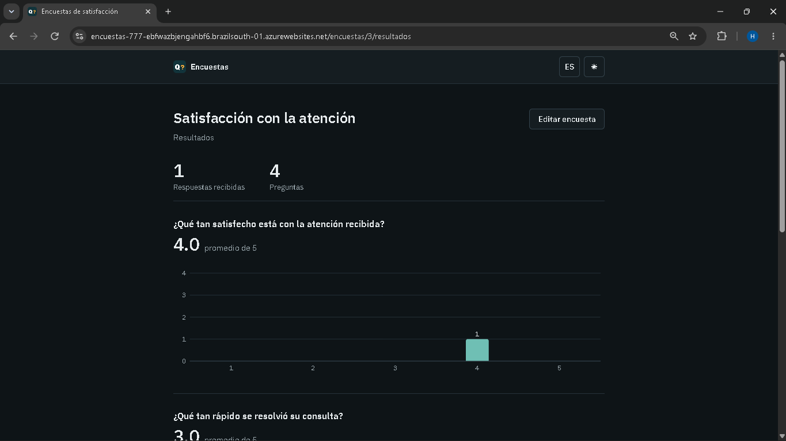
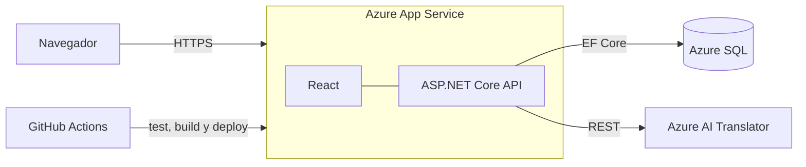
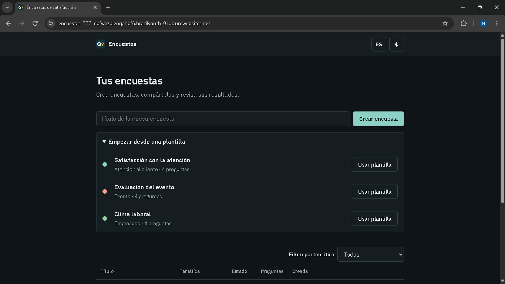
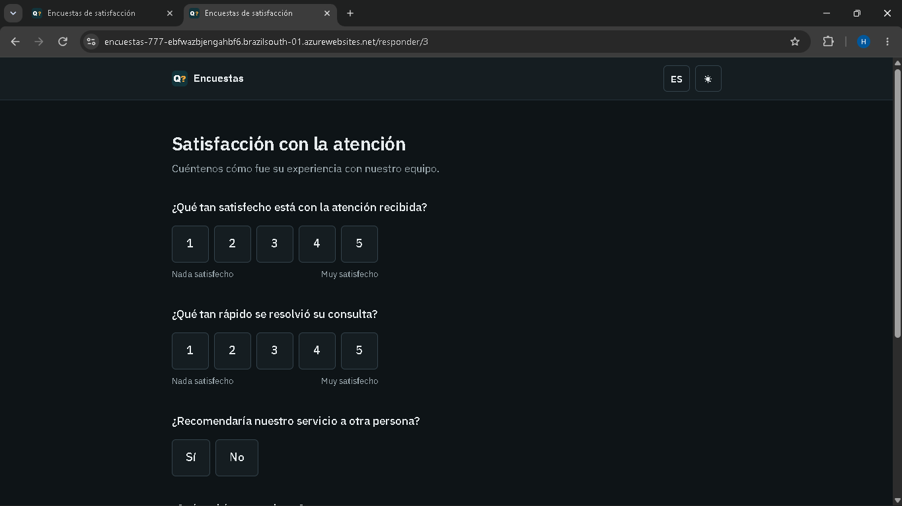
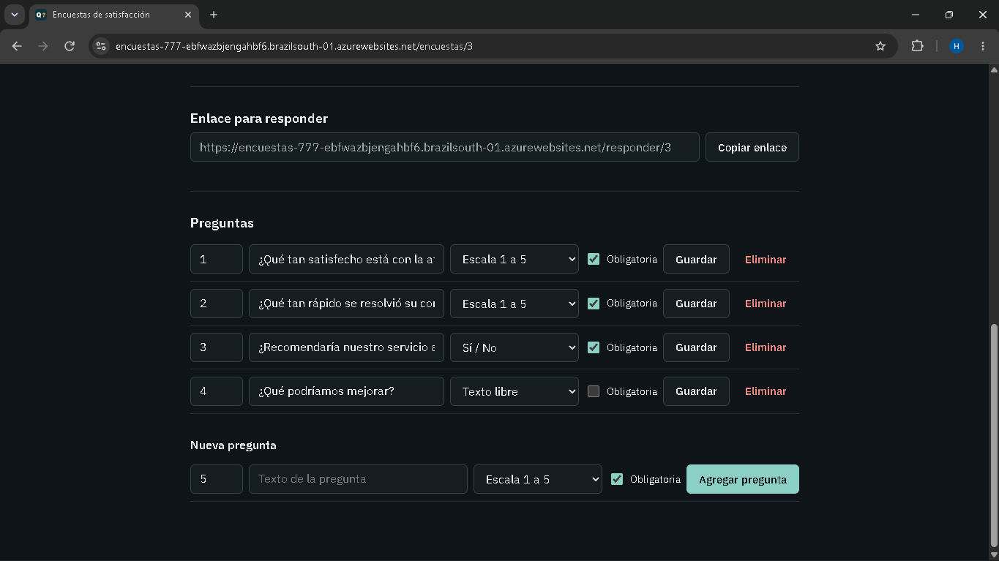

# Encuestas de satisfacción

[](https://github.com/777hv/Encuesta-Satisfaccion/actions/workflows/ci.yml)
[](https://github.com/777hv/Encuesta-Satisfaccion/actions/workflows/deploy.yml)

Aplicación full stack para crear encuestas de satisfacción, compartirlas con un enlace público y analizar los resultados con gráficas. Bilingüe (español / inglés) con traducción automática del contenido.

**[Ver demo en vivo](https://encuestas-777-ebfwazbjengahbf6.brazilsouth-01.azurewebsites.net)**. La primera carga puede tardar unos segundos porque la base de datos se pausa cuando no hay visitas.



## Funcionalidades
- Crear, editar y eliminar encuestas, desde cero o a partir de **plantillas** (atención al cliente, eventos, clima laboral).
- Preguntas de tipo **escala 1 a 5**, **sí/no** y **texto libre**, obligatorias u opcionales.
- Enlace público para responder, con **autoguardado** para continuar después.
- **Resultados** con promedio, distribución y comentarios.
- Interfaz en **español e inglés**. Encuestas y comentarios se traducen con **Azure AI Translator**.
- Temática y estilo visual por encuesta, con **modo claro y oscuro**.

## Tecnologías
| Capa | Tecnología |
|---|---|
| Backend | ASP.NET Core 10 Web API, Entity Framework Core, SQL Server |
| Frontend | React + Vite, React Router, Recharts |
| Calidad | xUnit, GitHub Actions (CI) |
| Nube | Azure App Service, Azure SQL Database (serverless), Azure AI Translator |
| Contenedores | Docker, Docker Compose |

## Arquitectura



Una sola App Service sirve la API en `/api/*` y el frontend de React en el resto de rutas.

El backend sigue una **arquitectura por capas** con inversión de dependencias:

```
src/
  Encuestas.Domain          Entidades (Encuesta, Pregunta, Respuesta). No depende de nada.
  Encuestas.Application     Casos de uso e interfaces (IEncuestaRepository, ITraductor).
  Encuestas.Infrastructure  EF Core + SQL Server y cliente de Azure Translator.
  Encuestas.Api             Controladores HTTP y configuración.
tests/
  Encuestas.Tests           Pruebas unitarias de la capa de aplicación.
frontend/                   React + Vite.
```

Las dependencias apuntan hacia adentro (Api → Application → Domain). Infrastructure implementa las interfaces de Application, así que la lógica no depende de la base de datos ni de Azure.

Algunas decisiones:
- **Traducción en memoria, nunca guardada:** el contenido original no se modifica. Las traducciones se cachean un día para no repetir llamadas, y si el servicio falla se muestra el texto original.
- **Reintentos con EF Core:** Azure SQL serverless se pausa sin uso, así que las conexiones se reintentan mientras despierta.
- **Sin secretos en el repositorio:** la cadena de conexión y la clave del traductor viven en user-secrets (local), en las variables de Azure y en los Secrets de GitHub.

## Capturas
| Encuestas y plantillas | Responder |
|---|---|
|  |  |
| **Editar preguntas** | **Resultados** |
|  |  |

## Cómo correrlo en local
Requisitos: .NET 10 SDK, Node 22 y SQL Server (o Docker).

```bash
dotnet test Encuestas.slnx
dotnet ef database update -p src/Encuestas.Infrastructure -s src/Encuestas.Api
dotnet run --project src/Encuestas.Api        # http://localhost:5080
cd frontend && npm install && npm run dev     # http://localhost:5173
```

La traducción automática es opcional. Sin clave, la app funciona sin traducir. Para activarla:
```bash
dotnet user-secrets set "Traductor:Clave" "<tu clave>" --project src/Encuestas.Api
dotnet user-secrets set "Traductor:Region" "<tu región>" --project src/Encuestas.Api
```

### Con Docker (API + SQL Server)
```bash
cp .env.example .env                          # y cambia la contraseña
docker compose up -d --build                  # API en http://localhost:5080
dotnet ef database update -p src/Encuestas.Infrastructure -s src/Encuestas.Api --connection "Server=localhost,1433;Database=EncuestasDb;User Id=sa;Password=<tu clave>;TrustServerCertificate=True"
cd frontend && npm install && npm run dev
```

## Despliegue
Cada `push` a `main` ejecuta [deploy.yml](.github/workflows/deploy.yml): corre las pruebas, compila React, lo publica dentro de la API y lo despliega en Azure App Service.
